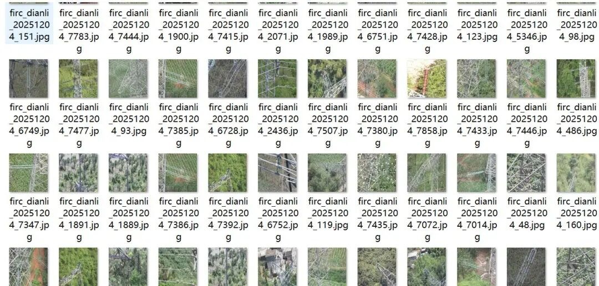
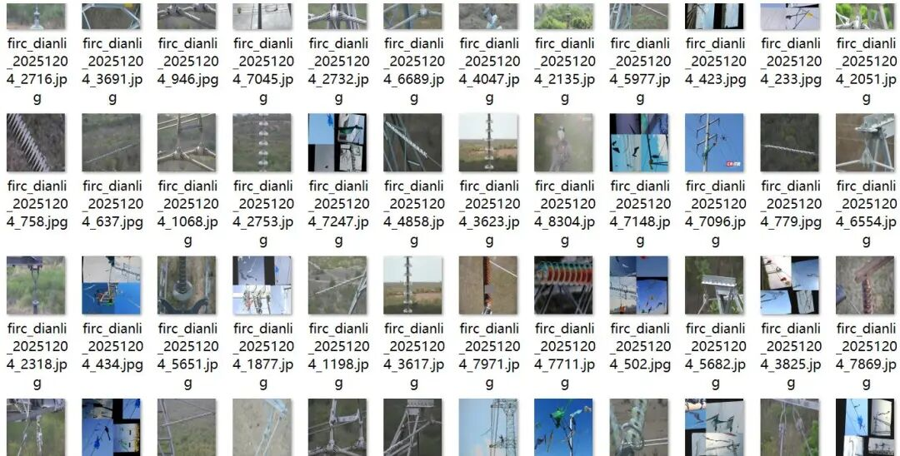
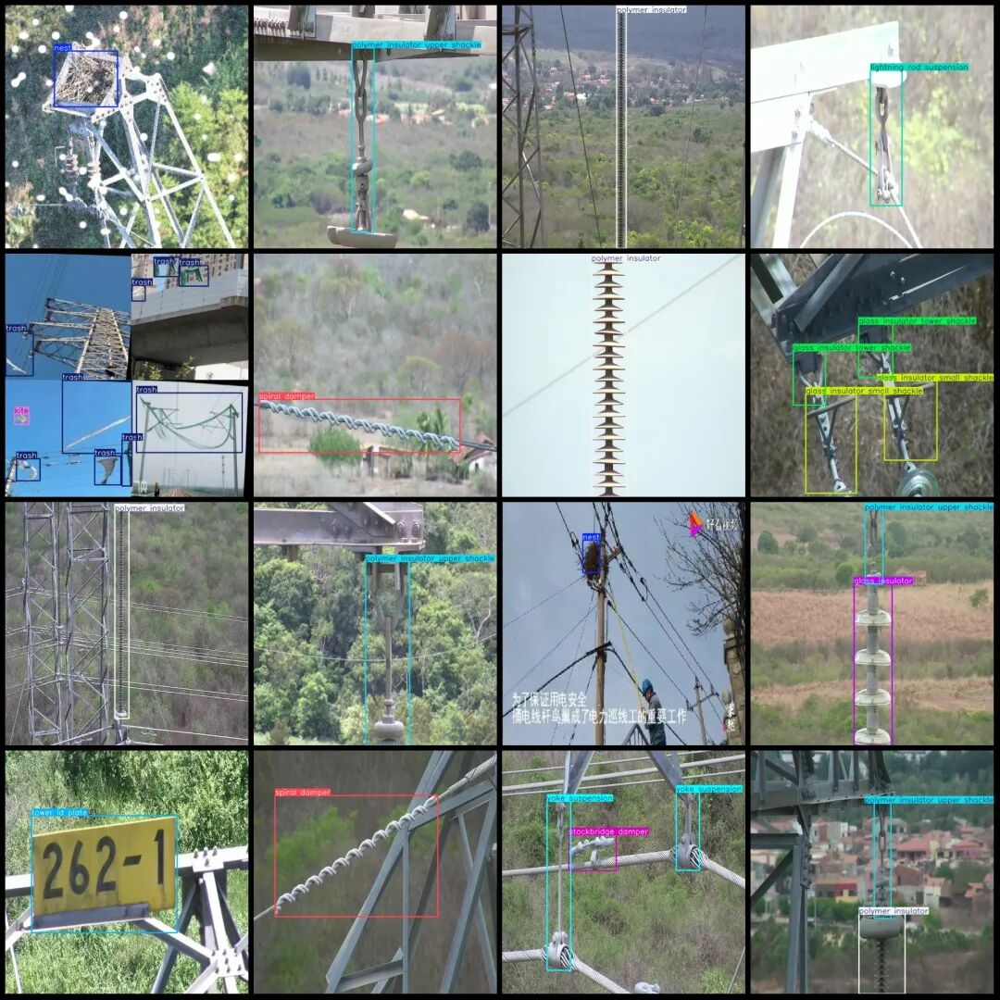
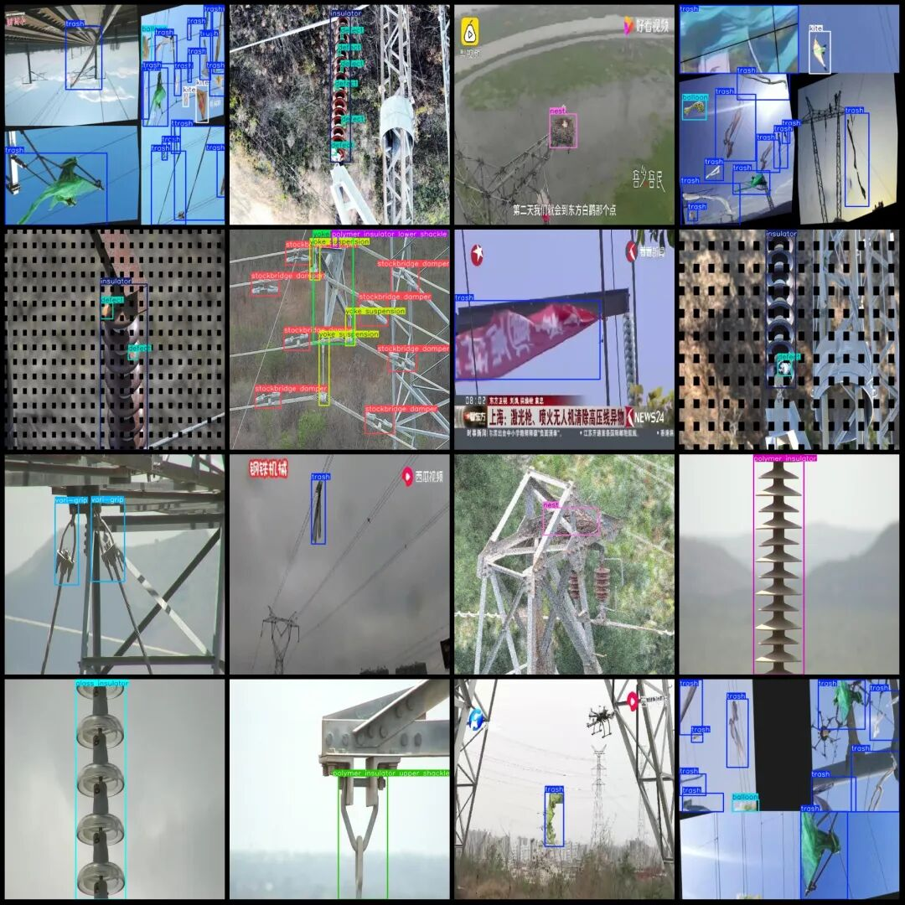

# Smart Grid Devices Dataset - Electric Circuit Safety Monitoring, Power Equipment Defects, Cable and Wires Foreign Object Intrusion, Kite-shaped Wind Turbine Bird Nest Detection Dataset in VOC+YOLO format with 9035 images across 25 classes

Dataset format: Pascal VOC format + YOLO format (txt file without split path, only containing jpg images and corresponding VOC format xml files and yolo format txt files)

Number of images (number of jpg files): 9035

Number of annotations (number of xml files): 9035

Number of annotations (number of txt files): 9035

Labeling category count: 25

Annotation category names (Note that the order of categories in the YOLO format does not correspond to this, but is based on the labels folder's classes.txt): ["balloon", "burst", "defect", "glass insulator", "glass insulator big shackle", "glass insulator small shackle", "glass insulator tower shackle", "insulator", "kite", "lightning rod shackle", "lightning rod suspension", "nest", "polymer insulator", "polymer insulator lower shackle", "polymer insulator tower shackle", "polymer insulator upper shackle", "spacer", "sphere", "spiral damper", "stockbridge damper", "tower id plate", "trash", "vari-grip", "yoke", "yoke suspension"]

Number of boxes labeled in each category:

Balloon (balloon) Frame Count = 503

Burst (Blast) Frames = 90

defect (defect) frame count = 2064

Glass insulator (glass insulator) frame count = 1225

Frame count = 106

Glass insulator small shackle (glass insulator small shackle) frame count = 112

Glass Insulator Tower Shackle (glass insulator tower shackle) Frame Count = 91

Insulator (insulator) Frame Count = 655

Kite (Kite) Frame Count = 574

Lightning rod shackle (Avoidance rod bracket) frame count = 170

Lightning rod suspension (Avoidance of lightning rod suspension) Frame count = 618

Nest (Bird Nest) Frames = 805

Polymer insulator (composite insulator) frame count = 2064

Polymer insulator lower shackle (composite insulator lower shackle) frame count = 767

Polymer insulator tower shackle (composite insulator tower bracket) frame count = 35

Polymer insulator upper shackle (composite insulator upper shackle) frame count = 1177

Spacer (spacer) frame count = 68

Sphere (Equal Pressure Ring) Frame Count = 15

Spiral damper (spiral damper) frame count = 819

Stockbridge damper (vibration damper) frame count = 3498

Tower ID Plate (Tower Number) Frame Count = 198

Trash (Foreign Object/Garbage) Frame Count = 6439

vari-grip (V-shaped wire clamp) frame count = 446

Yoke (Joint Plate) Frame Count = 537

Yoke suspension (Link Plate Suspension) Frame Count = 3096

Total frame count: 26172

Image resolution: 640x640

Whether the dataset includes enhanced images: a small portion, estimated to be no more than 500, mainly for stitching enhancements.

Using labelImg:

Annotation rules: Draw a rectangle around the category.

Important Notice: No

Special : This dataset does not guarantee the accuracy of the trained models or weight files.

Image Preview:

Annotation example:

## Payment

Here is a pay link on Stripe ( https://buy.stripe.com/3cs8yP7sY87d0vu9AB ). Please contact me lonlonago@foxmail.com after funding $89, and I will send you a complete data files , thank you!

